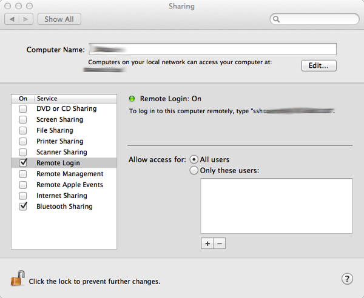

# SSH sem senha no OS X Mountain Lion

O SSH é um serviço de rede que permite fazer um login seguro em máquinas remotas. Basicamente, informa-se o login, o nome (ou endereço) da máquina à qual deseja-se conectar e depois a senha. Dependendo do uso que se faz do SSH, pode ser necessário e/ou conveniente configurar o software para guardar as senha com uma chave pública de forma que o login é feito de forma automática, sem a necessidade de perdir uma senha a cada pedido de login. De forma semelhante, quando trabalha-se com processamente paralelo utiizando, por exemplo, o MPI, é necessário que a máquina seja configurada para fazer o login no localhost sem pedir senha. Neste caso, isto acontece porque cluster são geralmente configurados em rede e para que a compilação possa aproveitar os processadores das diferentes máquinas localmente, é necessário que todas as máquinas sejam acessíveis na rede. Você consegue imaginar como seria a compilação e a execução de uma grande software de forma paralela em um ambiente de rede e tendo que digitar a senha de login das máquinas a todo instante? No caso dos processadores multicore, a situação é bastante semelhante: os softwares que podem tirar vantagem de máquinas com este tipo de processadore, enxergam cada um dos cores como um processador independente. Então, torna-se necessário configuarar a máquina em questão para que ela possa acessar ela mesma através do terminal via SSH. Confuso? É um pouco, mas é bastante simples.

Em uma máquina Linux, podemos gerar uma chave pública com os seguintes comandos:


```
$ ssh-keygen -t rsa 
```


```
$ cat ~/.ssh/id_rsa.pub >> ~/.ssh/authorized_keys2
```


No OS X Mountain Lion, o processo é bastante semelhante e requer uma configuração adicional:


```
$ ssh-keygen -t dsa -P '' -f ~/.ssh/id_dsa
```


```
$ cat ~/.ssh/id_dsa.pub >> ~/.ssh/authorized_keys
```


Mas para que tudo funcione, é preciso configurar o OS X Mountain Lion para permitir logins remotos. Para isto, basta abrir o painel de "Preferências do Sistema" (System Preferences), clicar no ícone "Compartilhamento" (Sharing) e marcar a opção "Login Remoto" (Remote Login).



Depois disso, basta testar:


```
$ ssh localhost
```


**Referências:**

- <http://stackoverflow.com/questions/7134535/setup-passphraseless-ssh-to-localhost-on-os-x>
- <http://www.vivaolinux.com.br/dica/SSH-sem-senha/>
