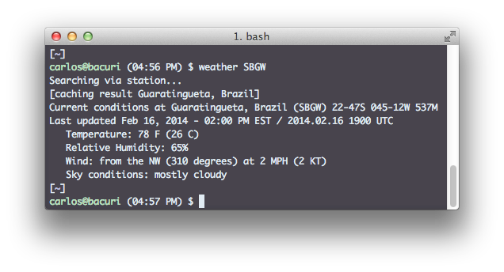
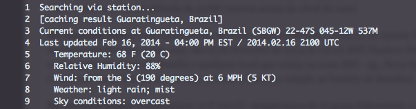

# Comando weather no OS X (condições do tempo)

Você sabia que é possível verificar as condições observadas de tempo a partir de estações meteorológicas pela linha de comando? No Linux é simples: basta instalar o programa "weather".


Se você utiliza o Debian ou derivados, instale com o comando:

```bash
$ sudo apt-get install weather-util weather-util-data
```

A utilização do comando é bastante simples. Por exemplo, para verificar a situação do tempo na cidade de Guaratinguetá/SP, basta digitar no terminal "weather SBGW" e obter as condições de tempo, veja abaixo:
[](../../../../assets/wordpress/2014/02/screen-shot-2014-02-16-at-4-58-03-pm.png) Recebendo as condições observadas do tempo com o comando weather para a cidade de Guaratinguetá/SP

SBGW é um código internacional de aviação civil ([ICAO - International Civil Aviation Organization](http://www.icao.int)) que identifica os aeroportos no mundo inteiro. Para saber mais sobre a estrutura dos códigos ICAO, clique [aqui](http://en.wikipedia.org/wiki/ICAO_airport_code).

Por algum motivo, o pacote weather não está disponível nos repositórios do macports. Mas você pode baixar o pacote manualmente e instalar no seu OS X. Para isto, basta seguir os passos abaixo:

**1) Obtendo o pacote "weather"**

Entre na página <http://fungi.yuggoth.org/weather/src/> e baixe a versão mais recente. Enquanto escrevo, a versão mais nova é a versão [2.0](http://fungi.yuggoth.org/weather/src/weather-2.0.tar.gz).

```bash
$ wget -c http://fungi.yuggoth.org/weather/src/weather-2.0.tar.gz
```

**2) Instalação**

Para instalar o pacote, basta descompactá-lo em uma pasta qualquer. Sugiro que coloque em /opt. Portanto, a partir da pasta onde você baixou o pacote do programa weather, faça:

```bash
$ sudo tar -zxvf weather-2.0.tar.gz -C /opt
```

E altere ao dono do diretório criado para o seu próprio usuário:

```bash
$ sudo chown -R USER /opt/weather-2.0
```

No comando acima, USER é o seu nome de usuário.

Feito isto, basta adicionar o programa ao PATH para que seja possível executar o comando weather a partir de qualquer pasta. Para isto, basta fazer:

```bash
$ vim ~/.profile
```

E adicione as seguintes linhas ao final do arquivo:

```bash
# Weather

export PATH=&amp;quot;/opt/weather-2.0&amp;quot;:${PATH}

export MANPATH=&amp;quot;/opt/weather-2.0/man&amp;quot;:${MANPATH}
```

Observe que adicionamos também os manuais ao MANPATH do sistema, assim pode-se consultar o manual do comando. Mas para que ele funcione devidamente, são necessários alguns ajustes. Primeiro, entre na pasta de instalação do weather em /opt/weather-2.0 e crie a pasta man:

```bash
$ cd /opt/weather-2.0

$ mkdir man
```

Depois, entre na pasta "man" criada e crie mais outras duas pastas:

```bash
$ cd man/

$ mkdir man1 man5
```

Veja que dentro da pasta "man", há duas novas pastas criadas "man1" e "man5", onde serão colocados dois arquivos que estão na raiz da pasta de configuração do weather: "weatherrc.5" e  "weather.1". Basta mover cada um dos arquivos para a pasta correta, da seguinte forma:

```bash
$ cd /opt/weather-2.0

$ mv weatherrc.5 man/man5

$ mv weather.1 man/man1
```

Depois de criadas as pastas e configurado o PATH, para que o comando funcione, é necessário abrir uma nova aba ou um novo terminal. Ou  executar o comando:

```bash
$ source ~/.profile
```

**3) Utilização do comando weather**

O comado weather é bastante simples e direto de se utilizar. O primeiro uso é aquele que já foi mostrado no início do post: basta escolher uma estação a partir do código ICAO e executar "weather CODIGO".

Basicamente, as informações que o weather mostra para uma estação ICAO, são as seguintes:

[](../../../../assets/wordpress/2014/02/screen-shot-2014-02-16-at-7-00-43-pm.png) Informações recuperadas pelo weather para a estação SBGW

**Linha 3:** Current conditions at Guaratingueta, Brazil (SBGW) 22-47S 045-12W 537M

Condições atuais em Guaratinguetá, Brasil (SBGW - código ICAO) latitudes 22S-47S, longitudes 45W-12W (onde W - West, refere-se a oeste) altitude de 537M (metros acima do nível do mar)

**Linha 4:** Last updated Feb 16, 2014 - 04:00 PM EST / 2014.02.16 21000 UTC, refere-se à data e horário da última atualização: neste caso, dia 16 de fevereiro de 2014 às 04:00 EST (Eastern Standad Time, ou seja, 2 horas a menos entre o horário de Brasília e qualquer local que esteja na zona EST - eg., Nova Iorque) ou 2100 UTC (Universal Time Coordinate, ou seja, 3 horas a mais em relação ao horário de Brasília).

****Linha 5**:** Temperature: 68 F (20 C) - temperatura de 68 graus Fahrenheit, o equivalente a 20 graus Celsius

****Linha 6**:** Relative Humiditty: 88% - umidade relativa do ar, em 88%

****Linha 7**:** Wind: from the S (190 degrees) at 6 MPH (5 KT) - direção do vento de "South" (ou seja, de Sul) a 190 graus, a uma intensidade (velocidade) de 6 milhas por hora ou 5 nós (ou seja, ~2,68 metros por segundo)

****Linha 8**:** Weather: light rain, mist - chuva fraca, chuvisco

**Linha 9:** Sky conditions: overcast - Condições de céu: encoberto

**4) Manuais**

Para mais informações sobre a utilização do comando weather, basta ler o manual:

```bash
$ man weather
```

e para as configurações, basta ler o manual:

```bash
$ man weatherrc
```

Outras informações, podem ser encontradas no site do programa.

É isso!

**Referências:**

- <http://www.omgubuntu.co.uk/2014/02/get-weather-forecast-terminal-linux>
- <http://fungi.yuggoth.org/weather/>
