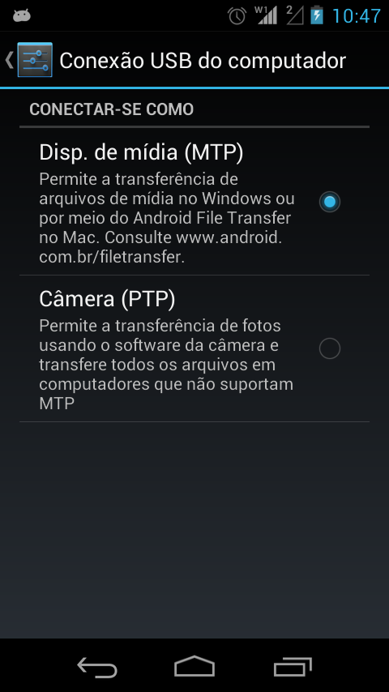
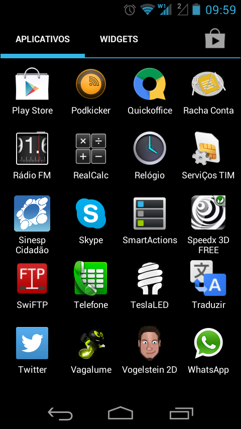
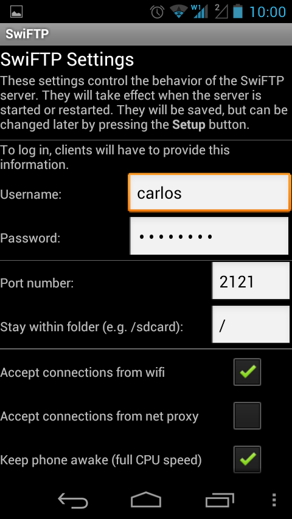
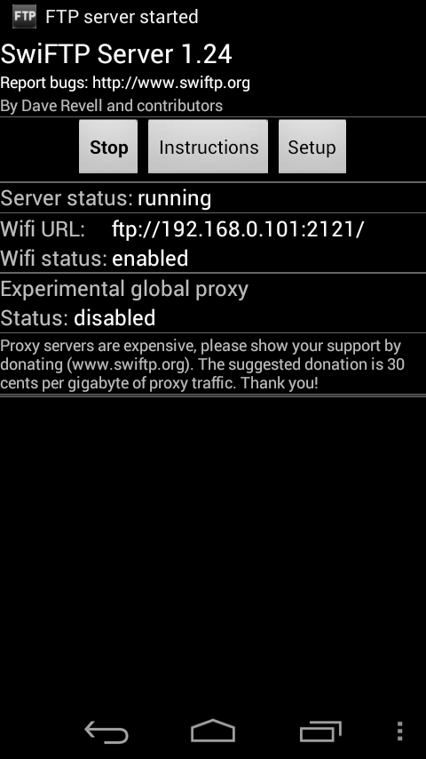
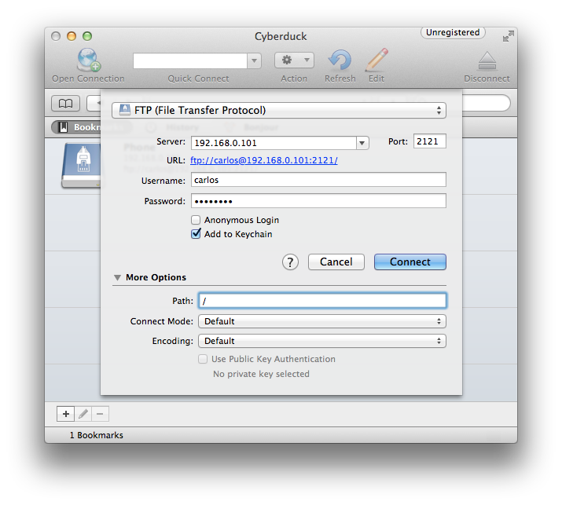
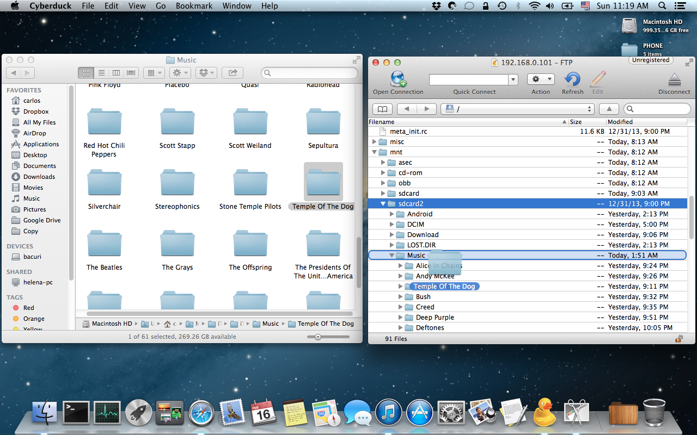

# Transferindo arquivos do OS X para um dispositivo Android

Transferir arquivos entre um computador e um smartphone ou tablet é algo bastante simples. Diversas opções estão disponíveis, desde ligar o smartphone ao computador via cabo USB até a sincronização via Bluetooth. No entanto, quando se trata de transferir grandes quantidades de dados (por exemplo, alguns gigabytes de músicas, filmes etc), muitas vezes pode ser inconveniente utilizar o bluetooth (pela limitação da velocidade da rede) ou via USB - neste caso especifico, dependendo do software utilizado, este tipo de tarefa tem as suas limitações.

O software Android File Transfer, foi feito com o objetivo de facilitar a vida de quem tem um dispositivo android e um computador com OS X. No meu caso, utilizando um smartphone [Motorola Razr D3](http://www.motorola.com.br/Motorola-RAZRD3/m-RAZRD3.html), ainda não consegui utilizar o Android File Transfer para colocar músicas no dispositivo. Este smartphone, quando conectado via USB ao computador, disponibiliza dois modos de conexão: o modo MTP (Media Transfer Protocol) e o modo PTP (Picture Transfer Protocol). O primeiro seria o modo de armazenamento em massa, e o segundo seria o modo de camera. O modo de armazenamento em massa permite que o computador enxergue o dispositivo como um pen drive, sendo possível a transferencia de arquivos de forma simples e direta. O modo de camera, permite que o computador enxergue o dispositivo como uma camera (D'oh!) e assim a transferência de fotos e vídeos pode ser feita utilizando um software de gerenciamento de fotos, como o Picasa ou iPhoto.

 Modos de conexão USB disponíveis no Motorola Razr D3

No Windows, qualquer um destes modos funciona sem nenhum tipo de problema, inclusive a sincronização entre o Windows Media Player e o dispositivo funciona perfeitamente no modo MTP. Mas no OS X, este modo não funciona, mesmo tentando utilizar o Android File Transfer e apenas o modo PTP funciona! Então, quais são as opções para quem tem um dispositivo Android e quer transferir dados entre o dispositivo e o OS X?

Algumas opções são as seguintes:

- Bluetooth
- [Airdroid](http://www.airdroid.com)
- [DoubleTwist](https://www.doubletwist.com)

Transferir dados via bluetooth tem a vantagem de ser rápida quando se tem poucos arquivos a transferir. Uma limitação está na transferência de pastas e na velocidade de conexão e distância entre o computador e o dispositivo. O Airdroid é um excelente software que além de permitir que você gerencie o seu dispositivo, permite também a transferência de dados. Mas duas limitações estão presentes: a transferência não permite que pastas inferiras sejam copiadas, sendo necessária a seleção de arquivos individualmente. Além disto, a transferência dos arquivos é feita diretamente na memória interna do dispositivo, ao invés do cartão de memória. O DoubleTwist é também um excelente player que permite a sincronização entre o computador e o dispositivo, mas tem a desvantagem de ser um software pago no que se refere a essa função.

Então, a solução que procuro, não está em nenhuma das opções acima mas compreende a utilização de um protocolo mais simples: o FTP (File Transfer Protocol).

A dica deste post é utilizar uma conexão FTP via rede interna (isto significa que ambos computador e smartphone devem estar na mesma rede) para troca de arquivos, nas duas direções. Eu poderia terminar o post por aqui e você poderia escolher as ferramentas que quiser para montar a conexão entre o seu computador e dispositivo Android. Mas vou um pouco mais além e dizer como eu fiz.

**1) Disponibilizando um "servidor" FTP no dispositivo Android**

Para isto, pode-se utilizar o app [SwiFTP](https://code.google.com/p/swiftp/). Para instalar, baixar o arquivo apk e instalar manualmente no dispositivo. Depois de instalado, configure o SwiFTP, indicando um nome de usuário e senha. É possível utilizar uma porta de FTP diferente da 2121, mas para não complicar a vida e atravessar o caminho de outros protocolos, basta deixar na forma como está:

 Abra o SwiFTP no Android

 Configurando o SwiFTP: basta criar um usuário e senha

 Servidor FTP ativo: acesso ao dispositivo é feito pelo endereço ftp://192.168.0.101:2121

**2) Acessando o dispositivo a partir do computador**

Com o servidor FTP disponível na mesma rede do computador (se eles estiverem acessando a mesma rede wireless, eles estarão na mesma rede), basta acessar o endereço indicado pelo SwiFTP no seu navegador favorito ou utilizando o seu programa FTP predileto. Sugiro o programa [CyberDuck](http://cyberduck.io), é gratuito e cumpre muito bem esta tarefa:

 Configurando o CyberDuck para acessar o servidor FTP do Android

Com o acesso ao servidor FTP do Android ativo, basta localizar a pasta do cartão de memória do Android (você deve encontrá-lo em /mnt/sdcard2) e arrastar e soltar os arquivos que você quiser, inclusive pastas inteiras!

 Transferindo arquivos entre o computador e o dispositivo Android, utilizando o CyberDuck e o SwiFTP

**Conclusão**

Esta dica mostra como utilizar o protocolo FTP para transferência de qualquer tipo de arquivo entre um dispositivo Android  e um computador com o OS X. Virtualmente, qualquer versão e dispositivo Android (smartphone, tablet etc) que acesse internet e qualquer sistema operacional (Linux, OS X, Windows etc) podem ser utilizados para a transferência de arquivos, resolvendo problemas de compatibilidade entre dispositivos, marcas e sistemas operacionais, sendo dispensável o uso de qualquer tipo de drivers para a conexão e transferência dos dados.

É isso!
