# Ferramentas para manutenção de bicicletas

Desde pequeno sempre desmontei minhas coisas. Não era raro quando eu desmontava e não conseguia remontar. Isso sem contar quando sobravam - ou faltavam peças! Meu pai, sempre me dizia: "você pode desmontar, mas vai ter que montar sozinho!". E assim cresci montando e desmontando minhas coisas, desde um carrinho, uma calculadora, um computador ou minha bicicleta.

Se você quer desmontar ou montar alguma coisa, tenha em mente o seguinte:
> Ter a ferramenta certa para o trabalho correto.

Partindo-se disto, resolvi escrever um pouco sobre algo que sempre fiz e que por um tempo deixei de fazer, mas que voltei a fazer recentemente :P - em meados do ano passado, resolvi dar um upgrade na minha bicicleta, uma Caloi Aluminum Pro Suspension, [1994 com grupo Alívio](http://www.retrobike.co.uk/gallery2/v/Manufacturer+Archive/Shimano+Archive/Catalogues/1994/1994+-+ALIVIO.jpg.html) da época - 95% original, pois eu havia trocado apenas o selim, as manoplas e os pedais. Comprei esta bicicleta em uma pechincha, paguei por ela 200 dilmas, realmente uma barganha!

 Eu e minha caloi aluminum

Mas uma coisa me incomodava nela: havia um amassado no quadro que só fui perceber muitos quilômetros depois... Não era algo que comprometia a sua dirigibilidade, era um problema mais estético - mas como o quadro já era debutante, um upgrade não iria demorar muito. Então, depois de pouco mais de três anos, resolvi aproveitar as peças dela e trocar o quadro. Sim, isto significa ter uma bicicleta praticamente nova, uma vez que um quadro novo e mais moderno me forçaria a comprar um garfo novo, pois o padrão de rosca do antigo não seria adequado para um quadro moderno.

Escolhidas as peças, veio a hora de montar. Ou não. Faltavam as ferramentas. Bem, depois de procurar aqui e ali, pegar algumas dicas com mecânicos em lojas de bicicletas, comprei algumas ferramentas que me permitiram realizar a montagem da bicicleta nova (removendo e reinstalando as peças antigas) e que atualmente me permitem realizar a manutenção básica da bicicleta.

Eis, portanto, as ferramentas básicas que você precisa para fazer a manutenção da sua bicicleta em casa e evitar ter que gastar uma graninha toda vez que for fazer a manutenção:

**0) Canivete de ferramentas**

Não é um canivete, mas é um canivete. É um item obrigatório, porque vai permitir que você trabalhe com todas as medidas de parafusos tipo [Allen](http://pt.wikipedia.org/wiki/Parafuso) que estão na sua bicicleta. Além disso, é indispensável andar com ele em uma trilha, sempre que algum parafuso afrouxar - principalmente os da caixa de direção, é ele quem vai resolver. O câmbio desregulou, o freio soltou? É com ele que você vai resolver:

[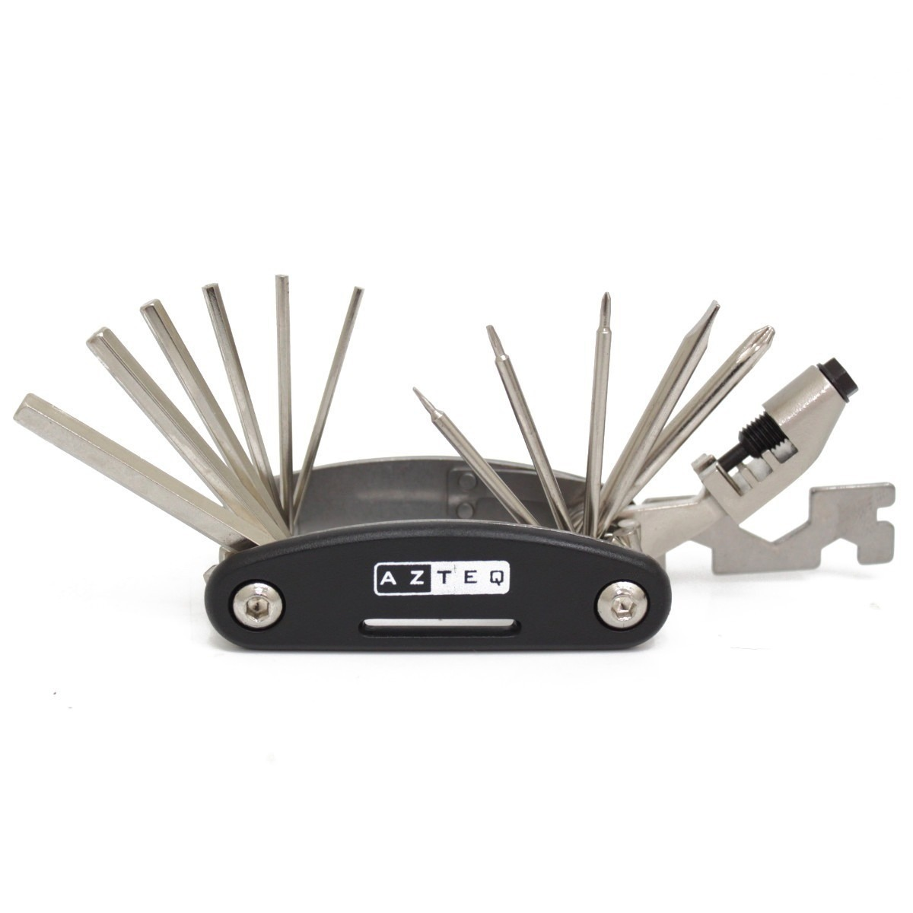](../../../../assets/wordpress/2014/02/canivete-de-ferramentas-p-bicicleta-bike-tool-2-azteq_mlb-f-3190361434_092012.jpg) Canivete

Os modelos mais simples sempre vem com um conjunto de chaves Allen, mas os mais sofisticados tem também extrator de correntes, chaves [Torx](http://pt.wikipedia.org/wiki/Torx) e bicos adaptadores para encher pneu. Neste tipo de ferramenta, as chaves mais utilizadas são as chaves Allen de 5 e 10 mm.

**1) Sacador de corrente**

Limpar a bicicleta e não limpar a corrente, é o mesmo que não limpar a bicicleta. Na verdade você não precisa remover a corrente para limpá-la, para isto você pode utilizar um produto para remover a graxa e uma escovinha. Depois basta lubrificar novamente - [veja aqui como fazer](http://www.bikemagazine.com.br/2011/06/limpeza-da-corrente/). Mas suponha que você queria trocar o [pedivela](http://pt.wikipedia.org/wiki/Pedivela): duas situações podem ocorrer. 1) a coroa maior do pedivela novo tem mais dentes que o antigo - então, talvez seja necessário colocar uma corrente maior ou adicionar novos elos; 2) a coroa maior do pedivela novo tem menos dentes que o antigo - então, você vai precisar encurtar a sua corrente. O sacador de corrente vai permitir que você faça este tipo de procedimento. Mas tome cuidado: há correntes que dispensam o uso deste tipo de ferramenta. O mais confortável, portanto, é utilizar um "[power link](http://en.wikipedia.org/wiki/Master_link)". Alguns modelos de corrente da [Shimano](http://www.shimano.com.br), [Sram](http://www.proparts.esp.br/sram), [KMC](http://kmcchain.us) etc, já vem com um link destes, mas se a sua corrente for dos modelos mais simples ou "populares", então um sacador de correntes vai lhe ajudar muito:

[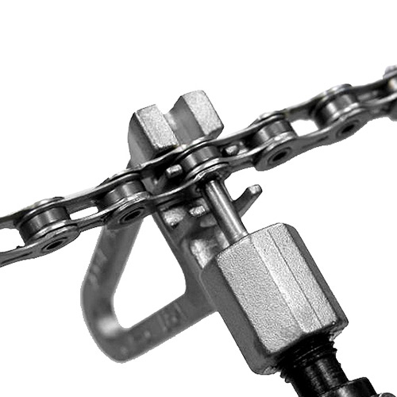](../../../../assets/wordpress/2014/02/7027358_1gg.jpg) Sacador de corrente

Clique [aqui](http://www.youtube.com/watch?v=8Pnz4OC_WR4) para ver um sacador de corrente em ação.

**2) Extrator de pedivela**

Sim, é pedivela. Esta chave, talvez você não vá usar com muita frequência, mas certamente é melhor remover o pedivela para limpeza, depois de uma trilha com muita lama. Com o tempo, a sujeira se acumula entre o [movimento central](http://en.wikipedia.org/wiki/Bottom_bracket) e o pedivela dificultando a limpeza, mesmo com esguicho de água. O extrator de pedivela é bastante simples de se utilizar, e bastante prático quando se tem um modelo como este:

[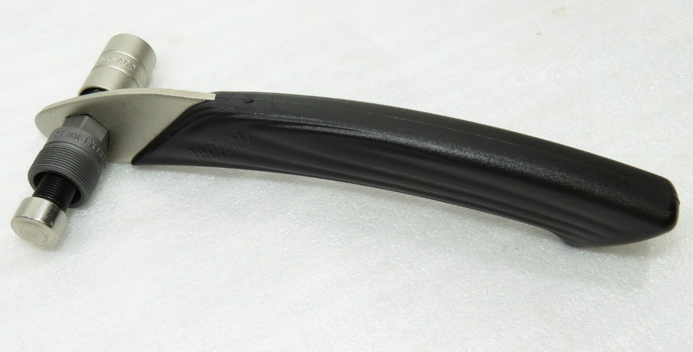](../../../../assets/wordpress/2014/02/ferramenta-extrator-pedivela-icetoolz-1415mm-com-cabo-8313-mlb20003562047_112013-f.jpg) Extrator pedivela

Este modelo é interessante porque permite a remoção de pedivelas com parafuso tipo Allen de 10mm ou com [cabeça sextavada](http://pt.wikipedia.org/wiki/Parafuso). Clique [aqui](http://www.youtube.com/watch?v=EV8sgC_XyJ8) para ver como extrair o pedivela como o extrator.

**3) Espátulas para remover pneu**

Trocar um pneu de bicicleta é uma tarefa simples. Há quem o faça apenas com as mão, mas se a sua bicicleta for de estrada (com pneus finos) é melhor utilizar espátulas para auxiliar a remoção da câmara ou mesmo do pneu por completo:

[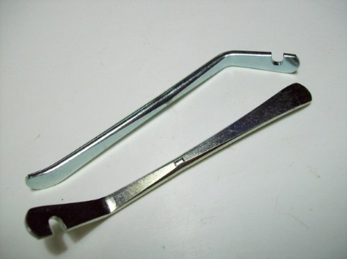](../../../../assets/wordpress/2014/02/espatula-de-aco-para-tirar-pneu-de-bicicleta_mlb-o-103610160_4665.jpg) Espátulas para remoção dos pneus

Há quem diga que os modelos de nylon ("plástico") são melhores porque evitam de "morder" a câmara e não arranham/amassam o [aro](http://en.wikipedia.org/wiki/Bicycle_wheel#Rim), mas eu tenho estes de metal e nunca tive problemas. Clique [aqui](http://www.youtube.com/watch?v=7PGM6wFtVPY) para ver como utilizar as espátulas para remover os pneus do aro.

**4) Extrator de movimento central**

Há vários tipos de movimento central, portanto, há vários tipos de extratores de movimento central. Talvez o mais comum hoje em dia, seja o extrator de movimento central selado. Você vai precisar utilizar esta ferramenta apenas se for instalar ou substituir o movimento central. O movimento central é o tipo de componente da bicicleta que, dependendo do tipo, utiliza-se durante anos (não é exagero dizer que as peças mais antigas duravam entre 5 a 10 anos!) sem a necessidade de remoção. Um extrator para movimento central selado tem o seguinte aspecto:

[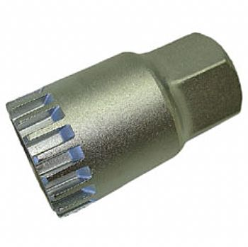](../../../../assets/wordpress/2014/02/grd_7_1921_extmovselado.jpg) Extrator de movimento central

Realizar a remoção do movimento central, principalmente destes modelos que são selados, requer um pouco de jeito (para segurar a ferramenta na posição correta) e força, porque com o passar do tempo, estas peças tendem a se prender no quadro. Clique [aqui](http://www.youtube.com/watch?v=EMnzlhIC0R8) para ver como utilizar o extrator do movimento central.

**5) Chave inglesa**

Sabe a chave inglesa? Então, ela é um tipo de ferramenta "coringa", é pau para toda obra. Você pode utilizá-la dentro de casa, no seu carro e também para apertar alguns parafusos da sua bicicleta:

[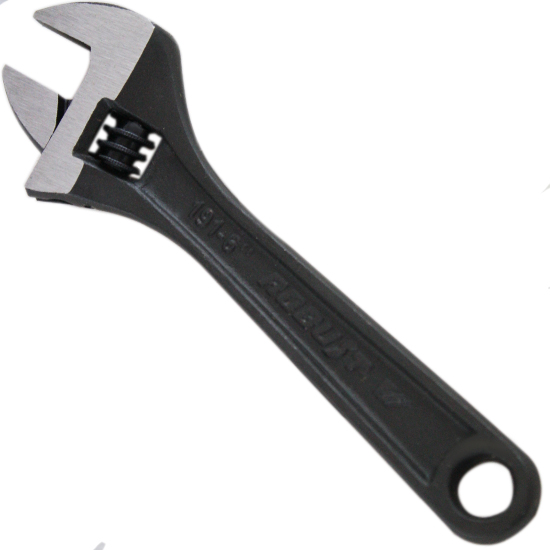](../../../../assets/wordpress/2014/02/chave_inglesa_6_pol_com_18_mm__34_04461_1.jpg) Chave inglesa

Tenha cuidado apenas para escolher um tamanho não muito grande. As mais apropriadas para manutenção de bicicletas, são as pequenas (6") e as médias (8"), com aberturas de 20 a 25mm, respectivamente. Talvez  a grande vantagem de se ter uma chave inglesa, é o fato de ela ter uma avalancha mais comprida do que as outras ferramentas do tipo, o que é uma vantagem para se fazer força.

**6) Chaves de boca**

Há alguns parafusos na bicicleta que a chave inglesa não vai conseguir apertar porque ela é uma chave de perfil grosso. Então, você vai precisar de algumas chaves de boca com medidas diferentes - e com perfis diferentes:

[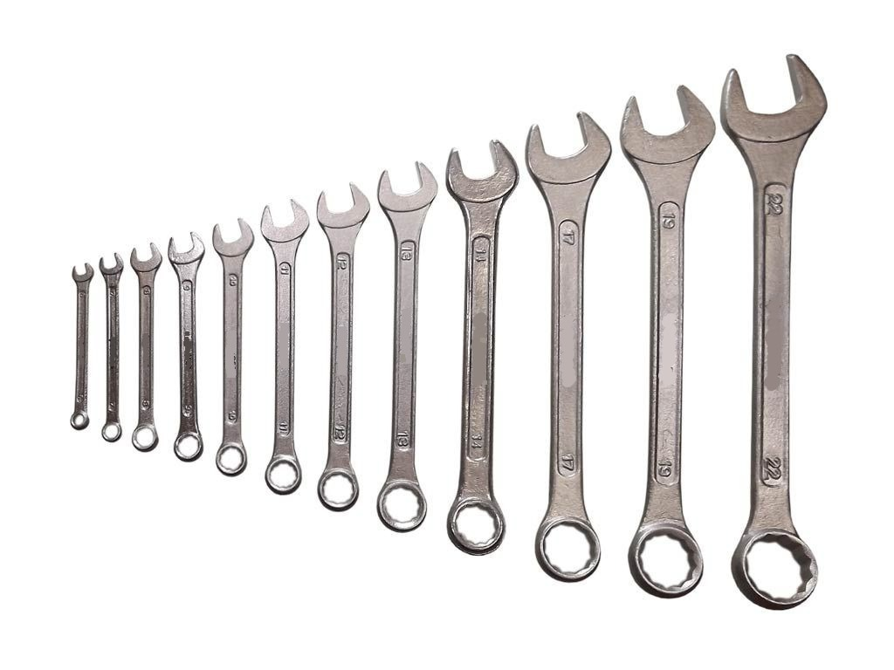](../../../../assets/wordpress/2014/02/jogo-de-chave-combinada-boca-e-estrela-estojo-7571-mlb5232743220_102013-f.jpg) Conjunto de chaves de boca

Novamente, dependendo do tipo de peças que você tem na sua bicicleta, é melhor ter ferramentas menores para facilitar o encaixe, mas sempre utilize as medidas corretas. Dentre estas ferramentas, a famosa "chave 10" (a chave de número 10, com 10mm de abertura) é a mais utilizada.

**6) Chave de raios**

Sabe quando você passa por um buraco ou dá aquela pancadinha na roda da bicicleta e ela fica torta? Então, quando você leva a roda na bicicletaria para alinhar, é com esta chave de raios que o mecânico resolve o problema. O alinhamento das rodas da bicicleta é extremamente importante, porque além de evitar que o aro fique raspando nas sapatas dos freios, evita também que os pneus se desgastem de forma errada, que os próprios raios quebrem (por estarem muito rígidos) e que o próprio quadro da bicicleta sofra danos - acredite, pneu raspando no quadro é pior do que lixa e faz estrago. A chave de raios, vai permitir que você faça o alinhamento das rodas da bicicleta até um nível aceitável. Digo isto porque quando se monta uma roda nova, um alinhamento 100% envolve a experiência de quem monta a roda e de mais alguns instrumentos que permitem um ajuste bastante fino da cambagem. Então, se você não for um expert no assunto, é melhor levar na bicicletaria para fazer o serviço, mas se você já sabe ou se sente à vontade, é bastante útil ter uma chave destas:

[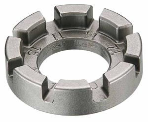](../../../../assets/wordpress/2014/02/imagem.jpg) Chave de raios

Clique [aqui](http://www.youtube.com/watch?v=W_h023uT0Ts) para ver como alinhas a roda de uma bicicleta utilizando uma chave de raios.

**7) Alicates**

Alicates são itens indispensáveis: você vai utilizá-los para puxar os cabos de freio e câmbios na instalação e durante a regulagem, para cortar sobras dos cabos e até para cortar os conduítes. Para tantas funções, um único tipo de alicate não existe, então é necessário ter alguns tipos à mão para cada tarefa. A maioria dos alicates vem com uma lâmina que permite "cortar" algumas coisas, mas nem tudo elas conseguem cortar. Cabos de freio tem maior espessura do que os de câmbio, mas com um alicate "universal" (sim, este que você está pensando de 8") é possível cortá-los. O mesmo não se pode dizer sobre os conduítes: primeiro porque conduítes são partes em que uma seção reta é difícil de fazer, pois eles são compostos por um filamento de aço helicoidal , o que dificulta o corte; e segundo, porque os conduítes de câmbio possuem também uma canaletasinha interna e estas devem estar desobstruídas para que o cabo passe livremente, sem fricção. Então, para cortar cabos usa-se um tipo de alicate e para cortar conduítes, usa-se outro tipo. Mas posso dizer que, com muito cuidado, é possível utilizar apenas um alicate para cortar cabos e conduítes e obter um resultado razoável. Quando utilizar um alicate universal para cortar um conduíte, certifique-se de uitilizar alguma ponta cônica para liberar a passagem do cabo, principalmente no conduíte de câmbio ([veja aqui como fazer](http://www.youtube.com/watch?v=T9uiLMzfo9s)).

[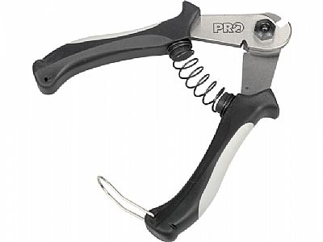](../../../../assets/wordpress/2014/02/20490-01-ferramenta-pro-alicate.jpg) Um alicate adequado para cortar cabos e conduítes

[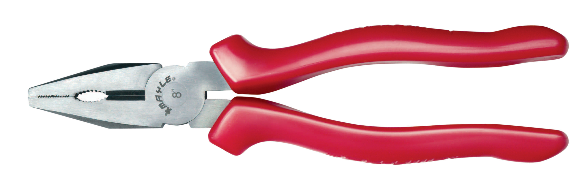](../../../../assets/wordpress/2014/02/8637.jpg) Um alicate universal de 8"

**8) Torquímetro**

Ninguém tem um [torquímetro](http://pt.wikipedia.org/wiki/Torqu%C3%ADmetro) em caso. A não ser que você realmente saiba o que está fazendo, acho que é até difícil encontrar um para comprar (ok, aqui na minha cidade não é fácil encontrar). Quando você começar a usar um torquímetro, com certeza você estará em um nível mais avançado de manutenção de bicicleta e já deverá possuir várias ferramentas. O torquímetro serve para aplicar a força correta no aperto de um parafuso. Claro, afinal nem de contas, qual a quantidade de força que a gente deve aplicar no aperto de um parafuso? Peças de bicicleta que são mais sofisticadas e que proporcionam precisão e desempenho ao ciclista, são projetadas para receberem um aperto específico. Isto garante o adequado funcionamento da peça e consequente resultado procurado. Peças fabricadas em materiais mais nobres e caros como o Carbono, requerem uma quantidade exata de força no aperto e ajuste. Caso contrário, além de prejudicar o funcionamento do componente, pode causar o desgaste prematuro e até a quebra. Mas para a maioria de nós, com componentes comuns e sem grandes  requerimentos, o bom aperto é aquele que fica entre o seu bom senso e os seus músculos ;)

[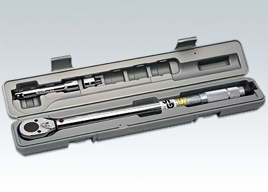](../../../../assets/wordpress/2014/02/6212.jpg) Um torquímetro

A seguir, um instrumento muito importante que vai lhe auxiliar a saber quais as medidas mais adequadas entre parafusos, porcas e ferramentas. Veja [aqui](http://www.youtube.com/watch?v=vDPnzrneBq8) como utilizar um torquímetro para ajustar a sua bicicleta.

**9) Paquímetro**
[Paquímetro](http://pt.wikipedia.org/wiki/Paqu%C3%ADmetro), não [paquiderme](http://pt.wikipedia.org/wiki/Paquidermes)! Você não vai usar um paquímetro para apertar ou soltar nada na sua bicicleta, até porque ele é um instrumento de precisão e não uma chave de torque! Você vai usar um paquímetro para medir e conhecer as dimensões da sua bicicleta. Suponha que você queira substituir o movimento central. Entre os tipos e modelos, há apenas um tipo que cabe no seu quadro. Que tipo é este? Você descobre medindo o "[shell](http://en.wikipedia.org/wiki/Bottom_bracket#Shell_diameters_and_threading)" do movimento central com o paquímetro! Depois de descobrir esta medida, você precisa saber qual é o comprimento do eixo! Como se faz isso? Meça com o paquímetro! Mas tome cuidado com ele, é um instrumento de precisão: nada de jogar na caixa de ferramentas, guarde-o em uma capinha, sempre limpo e ajustado. ;)

[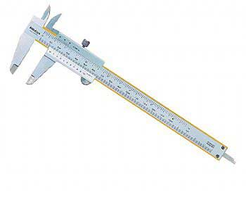](../../../../assets/wordpress/2014/02/grd_176_paquimetro.jpg) Paquímetro

**Outras ferramentas e conclusão**

Dependendo dos tipos de componentes que a sua bicicleta possui, talvez sejam necessários outros tipos de ferramentas, como chaves Torx e outras ferramentas mais específicas. Mas com certeza, as ferramentas aqui apresentadas podem atender a pelo menos 90% das bicicletas para uma manutenção básica. Tenha em mente que fazer a manutenção da sua própria bicicleta é algo que deve ser prazeroso e calmo: não adianta querer fazer a manutenção com pressa, sempre vai faltar alguma detalhe. Faça com calma. Se você não conseguir remover, apertar ou instalar algum tipo de componente, leve a peça ou a bike até uma oficina e explique o que você está tentando fazer. Evite que os parafusos e porcas entortem e estraguem. Eu sempre consegui ajuda dos mecânicos perto de casa, então não custa pedir uma ajudinha de vez em quando!

Caso você queira comprar as suas próprias ferramentas, escolha boas marcas, nada de [ferramentas de R$ 1,99](http://www.youtube.com/watch?v=oj72xcWrqKU): além de serem de péssima qualidade, elas podem danificar o seu equipamento. Prefira as ferramentas de marcas como [Tramontina](http://www.tramontina.com.br/produtos/categorias/1123-ferramentas/) ou outras fabricadas com um bom material, como o [aço cromo vanádio](http://www.timken.com/pt-br/products/Steel/productlist/types/Pages/ChromiumVanadium.aspx). Ferramenta boa, desde que bem aplicada, não quebra, não entorta e dura a vida toda :)

Agora, se você realmente está interessado em ferramentas específicas para bicicleta, para uso hobby/profissional, recomendo que comece a olhar as ferramentas da [ParkTool](http://www.parktool.com).

É isso!
