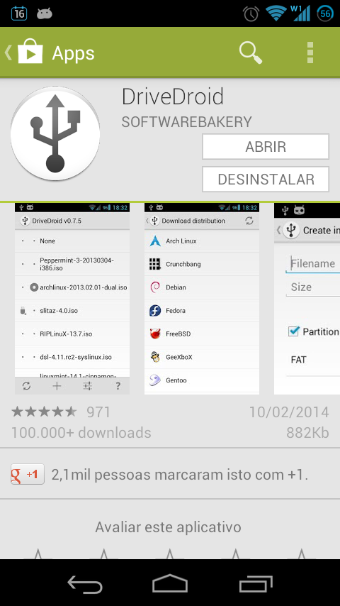
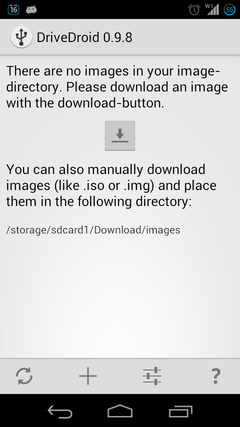
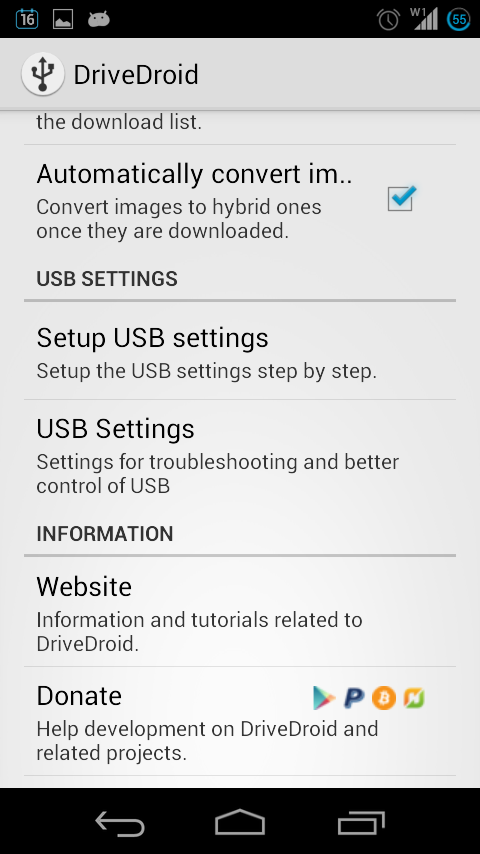
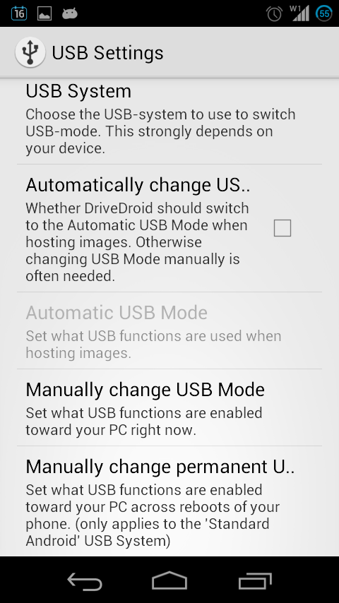
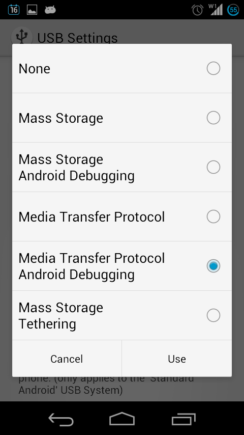
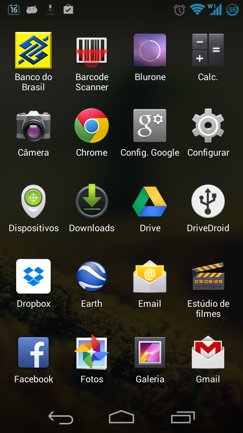
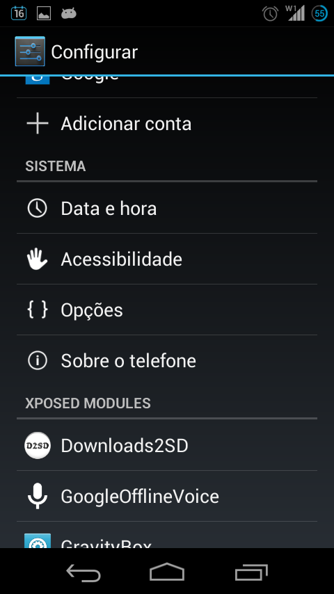
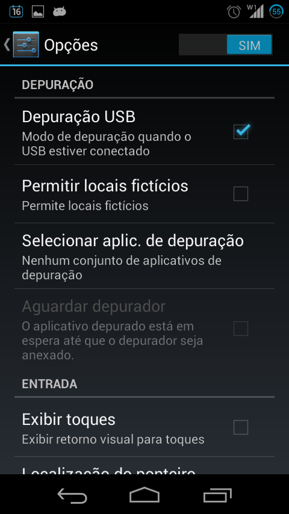
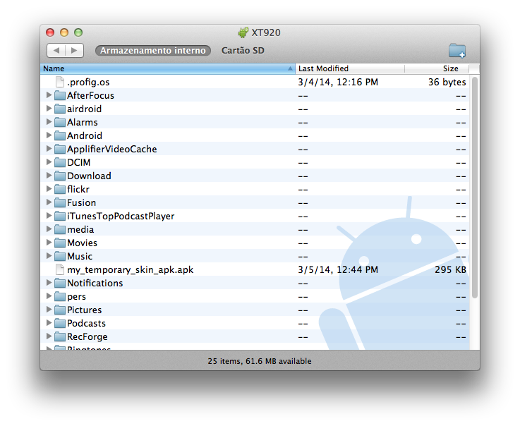
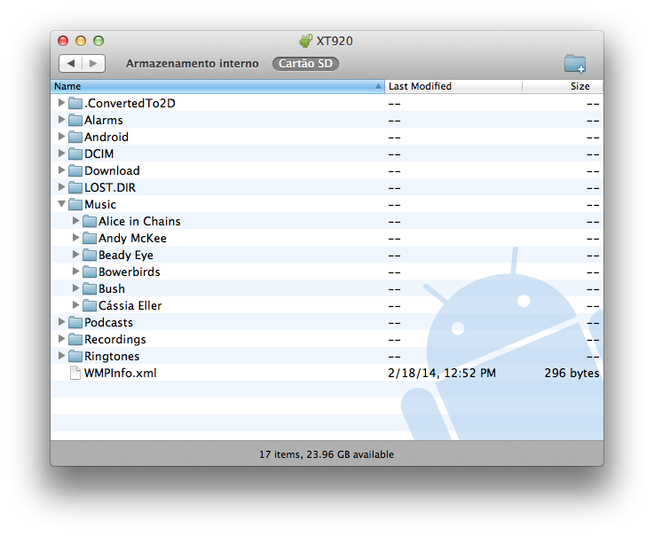

# Transferindo arquivos para o Motorola Razr D3 (XT920) com o Android File Transfer no OS X

Quando adquiri meu [Motorola Razr D3](http://www.motorola.com.br/Motorola-RAZRD3/m-RAZRD3.html), qual não foi minha decepção ao perceber que não conseguiria transferir minhas músicas e arquivos entre ele e o OS X utilizando o [Android File Transfer](http://www.android.com/filetransfer/)? Depois de pesquisar por alguma solução, acabei escrevendo um [post](../../02/16/transferindo-arquivos-do-os-x-para-um-dispositivo-android-wp-2216.md) com algumas alternativas para sanar este problema, mas obviamente, nenhuma delas tão prática quanto ligar o telefone pela porta USB e transferir arquivos, assim como é possível fazer no Windows. No OS X, entretanto, esta tarefa não parecia ser tão simples assim... Mas eis que surge uma solução, e simples!

Para transferir arquivos para o Motorola Razr D3 (também conhecido como XT920) com o Android File Transfer no OS X, tive que instalar um app no Android chamado "[DriveDroid](http://softwarebakery.com/projects/drivedroid)". Este app serve para instalar baixar e instalar uma imagem do Linux no seu computador, servindo como uma alternativa de recuperação caso você não tenha opções em um momento de crise (muito útil!!) :D Mas o que interessa mesmo, é que este app possui uma interface para gerenciar e alterar a forma como o seu Android se comunica com o seu computador através da interface USB. Então, para resolver o problema de conexão que o Razr D3 possui como o OS X, vamos a um passa a passo. Mas antes de mais nada, é necessário que o seu telefone seja rooteado. Se você não sabe o que é isto, PARE POR AQUI. Eu não serei responsável por quaisquer danos causados ao seu telefone e qualquer tipo de perda de dados e informações. Faça por sua própria conta e risco.

**A partir deste ponto, estou assumindo que o seu Motorola Razr D3 (XT920) é roteado , que você sabe o que está fazendo e que você é inteiramente responsável por isto.**
**1) Instale o DriveDroid a partir da [PlayStore](https://play.google.com/store/apps/details?id=com.softwarebakery.drivedroid)**
 Instale o DriveDroid a partir da PlayStore (versão gratuíta)

**2) Se o root perguntar se você quer dar permissão para que o DriveDroid seja executado, permita**
**3) Abra o DriveDroid e clique no ícone de painel de controle (ajustes)**
 Clique no ícone de ajustes (terceiro ícone na parte de baixo)

**4) Clique na opção "USB Settings"**
 Selecione a opção "USB Settings"

**5) Clique em "Manually change permanent USB Mode"**
 Selecione "Manually change permanent USB Mode"

**6) Selecione a opção "Media Transfer Protocol Android Debugging" e clique no botão "Use"**
 Escolha a opção "Media Transfer Protocol Android Debugging"

Após isto, você terá que habilitar a opção de deputação USB no seu telefone:

**7) No App drawer do Android, clique no ícone "Configurar"**
 Acesse as configurações do seu telefone

**8) Role a tela até a opção "Opções"**
 Selecione "Opções"

**9) No alto, à direita, há um seletor "Sim/Não", certifique-se se que "Sim" está selecionado e assim obtenha acesso a configurações avançadas do Android**
 Habilite a opção de "Depuração USB"

**10) Na mesma tela, role até a opção "Depuração USB" e selecione-a**

A partir disto, seu telefone deverá ser reconhecido pelo OS X e ao plugá-lo no computador, o Android File Transfer (que deverá estar instalado no computador), deverá abrir automaticamente.

 Android File Transfer e Motorola Razr D3 no OS X (browser do armazenamento interno)

 Android File Transfer e Motorola Razr D3 no OS X (browser do cartão SD)

A princípio, esta mesma abordagem poderá ser utilizada em outros modelos/marcas de telefones com Android, desde que suportem o app DriveDroid.

**Referência:**

- <http://trjlive.com/2013/10/guide-android-file-transfer-mac-osx-mavericks/>
