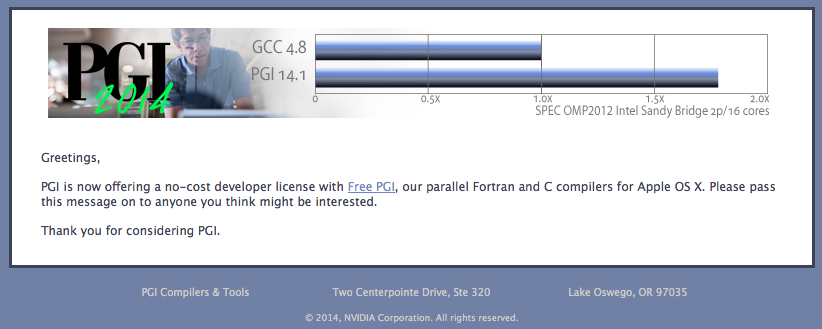
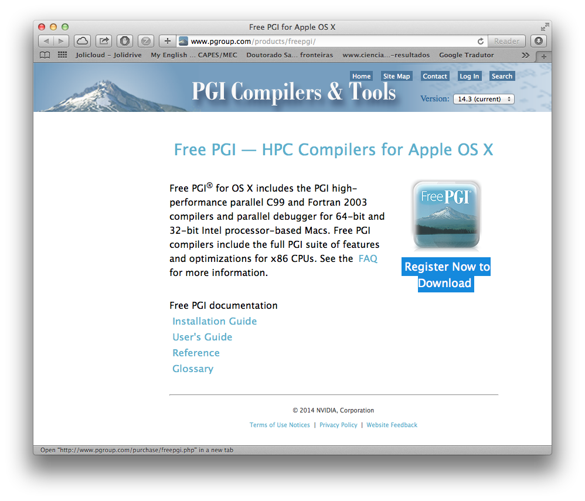
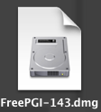
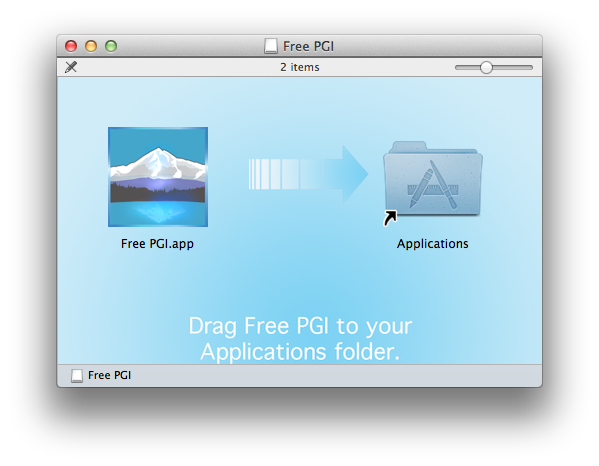
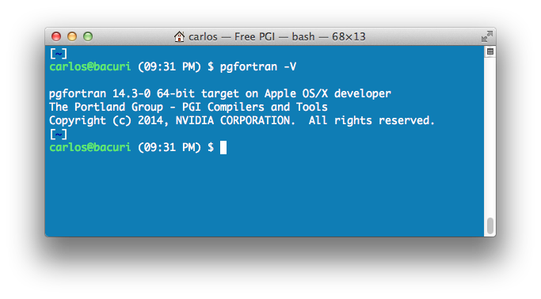
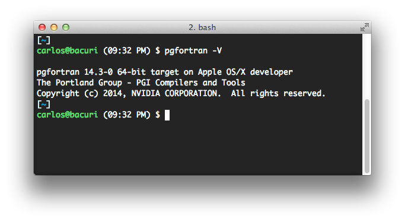

# Instalando a suite Free PGI no OS X (e mais um pouco)

Esta semana a [Portland Group](http://www.pgroup.com/index.htm) - empresa desenvolvera de compiladores fortran e C (e outros produtos), lançou uma versão gratuita de seus compiladores para o OS X (exceto o compilador C++). Infelizmente, uma versão gratuita ainda não parece estar disponível para o Linux ou Windows. A instalação é bastante simples e direta: basta abrir uma imagem DMG e arrastar o aplicativo para a pasta Applications do OS X. Mas acontece que a utilização dos compiladores fica restrita apenas ao [Terminal.app](http://en.wikipedia.org/wiki/Terminal_(OS_X))! Isto significa dizer que, caso você utilize outro emulador de terminal, como o [iTerm2.app](http://www.iterm2.com), você simplesmente não consegue invocar os compiladores! Isto acontece porque para utilizar os compiladores, você não deve abrir o Terminal.app, mas você precisa clicar no ícone do programa instalado (Free PGI.app) e aí sim ele abre um terminal e então os compiladores podem ser utilizados. Mas que bobagem...


Então, dando uma olhada na forma como o Free PGI.app funciona, percebi que ele executa um script que exporta as variáveis de ambiente antes de abrir o Terminal.app. Por isto que não adianta apenas abrir o terminal e sair usando. O problema é que este script é apenas um executável e este não pode ser devidamente lido (como texto). Mas eis que quando o Terminal.app é carregado, algumas variáveis de ambiente são exportadas e estas podem ser colocadas no seu .profile (ou .bashrc) e assim, você pode utilizar os compiladores PGI sem a necessidade de abrir o programa Free PGI.app e além disso, pode também utilizar o emulador de terminal que quiser!

[](../../../../assets/wordpress/2014/04/screen-shot-2014-04-04-at-8-55-43-pm.png) PGI lança versão gratuíta dos seus compiladores para o OS X.

Abaixo, mostro como baixar e instalar os compiladores e configurar o sistema para que seja possível utilizar os compiladores em qualquer emulador de terminal.

**1) Baixando o arquivo de instalação**

Para baixar o arquivo de instalação, é necessário ter uma conta de acesso no site da Portland Group. Depois, basta acessar o endereço [Free PGI](http://www.pgroup.com/freepgi) e clicar em "Register Now To Download". Na próxima página, basta clicar em "I Agree" ao final da página e na página seguinte (já com sua conta criada e ativada), faça login. Siga as instruções e obtenha o arquivo de instalação.

[](../../../../assets/wordpress/2014/04/screen-shot-2014-04-04-at-9-01-17-pm.png)
**2) Instalando**

Abra o arquivo de instalação e arraste o ícone "Free PGI" para a pasta Applications do OS X. Em seguida, clique no ícone do programa Free PGI a partir da pasta Applications. Fazendo isto, uma janela do Terminal.app irá se abrir e então a configuração estará completa.

[](../../../../assets/wordpress/2014/04/screen-shot-2014-04-04-at-9-06-35-pm.png) Imagem DMG do arquivo de instalação.

[](../../../../assets/wordpress/2014/04/screen-shot-2014-04-04-at-9-07-08-pm.png) Instalando o Free PGI

Basicamente, a instalação pára por aí. Não é necessário inserir um serial ou ativar utilizando uma licença flex, tal como era feito com as versões triais dos compiladores.

Para utilizar os compiladores, como dito anteriormente, basta abrir o programa "Free PGI" e então uma janela do Terminal.app irá se abrir com as configurações de ambiente ajustadas.

[](../../../../assets/wordpress/2014/04/screen-shot-2014-04-04-at-9-31-54-pm.png) Testando a instalação do Free PGI - instalação padrão no Terminal.app

**3) Indo um pouco mais além**

A forma como a Portland Group idealizou a distribuição do programa, deixa bastante claro que você não tem muitas possibilidades de alterar a forma como o programa se comporta. Então, se você trabalha com muitos terminais, gosta de dividir a janela do terminal em várias partes etc, então você sabe que o Terminal.app é limitado nestes termos. Além disso, ter que abrir um programa para somente depois ter acesso aos compiladores é meio estranho. Não é mais simples abrir o seu emulador de terminal favorito e começar a trabalhar, assim como você faria caso estivesse compilando os seus códigos com o GCC? Mas é claro!

Então, para expor as variáveis de ambiente da instalação do Free PGI para a sua conta de usuário, basta copiar as linhas abaixo e colocar no seu .profile ou .bashrc (ou seja lá o que você utiliza para carregar as suas configurações de terminal):

```bash
# PGI Environment Settings
export PGI_PGI_PATH=&quot;/Applications/Free PGI.app/Contents/Resources/pgi&quot;
export PATH=&quot;/Applications/Free PGI.app/Contents/Resources/pgi/osx86-64/14.3/bin:$PATH&quot;
export PGI_OEM_INFO=&quot;64-bit target on Apple OS/X developer $INFOTPVAL&quot;
export PGI_GCCVERSION=&quot;40201&quot;
export PGI_GCCINC=&quot;/Applications/Xcode.app/Contents/Developer/usr/lib/llvm-gcc/4.2.1/include&quot;
export PGI_GCCDIR64=&quot;/Applications/Xcode.app/Contents/Developer/usr/lib/llvm-gcc/4.2.1&quot;
export PGI_MINOSX=&quot;10.9.2&quot;
export PGI_MINOSX=&quot;10.9.2&quot;
export PGI_MINOSXNUM=&quot;109&quot;
export PGI_HASGCC_EH=&quot;0&quot;
export PGI_ISCLANG31=&quot;501&quot;
export PGI_LOCALDEFS=&quot;__PGI_5XC__&quot;
```

Você deve observar, no entanto, que algumas variáveis exportadas contém informações específicas da versão do OS X e GCC. Se você não estiver utilizando o OS X 10.9.2 junto com as últimas atualizações do Xcode, então você terá que alterar algumas variáveis e substituir os valores pelos correspondentes das suas configurações.

[](../../../../assets/wordpress/2014/04/screen-shot-2014-04-04-at-9-32-43-pm.png) Testando a instalação do Free PGI - instalação exposta para o iTerm2.app (e outros emuladores).

**Conclusões**

Acredito que a Portland Group deve ter atendido a uma demanda de muitos usuários (talvez, principalmente estudantes). A empresa deixa bem claro que a única forma de suporte deste produto é a partir do [fórum](https://www.pgroup.com/userforum/index.php) e que nenhuma outra forma está disponível, especificamente para este produto. A dica mostrada aqui, expondo as variáveis do sistema que são exportadas por um script "binário" do programa Free PGI.app não fere nenhum contrato de utilização do produto simplesmente porque estas variáveis podem ser recuperadas pelo terminal. Então nenhuma engenharia reversa foi feita, apenas foi entendido a forma como o programa funciona.

É isso!
