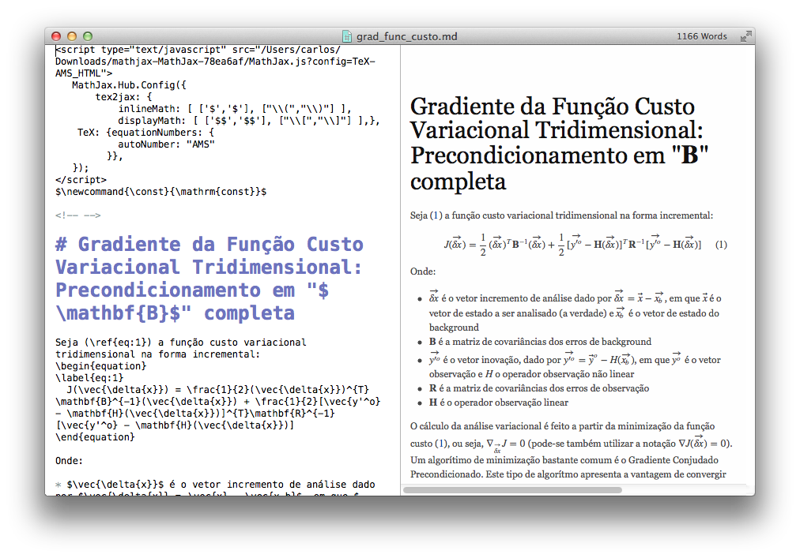

# Markdown + MathJax: Uma alternativa ao LaTeX

Recentemente o [Markdown](https://daringfireball.net/projects/markdown/) vem demonstrando - com sua simplicidade (e elegância), como uma [sintaxe](https://daringfireball.net/projects/markdown/syntax) de texto puro pode ser objetiva e produtiva. Exemplos de sua aplicação vão desde editores de texto estilo desktop até os mais simplificados editores embarcados em smartphones e tablets. Além disso, alguns serviços disponibilizam o Markdown como alternativa a outras linguagens. Como exemplo, pode-se citar [Scriptogr.am](http://scriptogr.am),  [GitHub Pages](https://pages.github.com) e [Wordpress](http://en.blog.wordpress.com/2013/11/19/markdown/). Marcar um texto ao invés de formatá-lo é uma tarefa muito mais simples, pois escreve-se o texto na forma como ele deve ser apresentado. Nada de ter que escrever e depois formatar, basta "marcar". O [LaTeX](http://www.latex-project.org) é uma destas linguagens que facilitam a vida de quem escreve textos científicos, principalmente quando há a necessidade de se inserir equações. Mas muitas vezes, a sua complexidade acaba contradizendo o seu principal mote: o de manter o foco no conteúdo, e não na aplicação. Textos muito grandes em editores [WYSIWYG](http://en.wikipedia.org/wiki/WYSIWYG) é uma tarefa que demanda paciência, e digitar equações, demanda mais paciência ainda.


Originalmente, o Markdown não inclui renderização de equações, tal como o LaTeX; o LaTeX, foi feito para isto. Mas se o caso for escrever textos pequenos, ou apenas documentar uma derivação matemática, o Markdown pode resolver, desde que se esteja utilizando um editor Markdown que apresente a capacidade de renderizar equações LaTeX. Alternativamente ao LaTeX, considerando-se uma instalação local padrão, algumas alternativas estão disponíveis, como por exemplo, o [MathJax](http://www.mathjax.org). O MathJax é um script server-side que permite renderizar equações escritas em LaTeX em qualquer browser (que tenha a capacidade de interpretar JavaScript). O MathJax pode também ser utilizado para renderizar equações LaTeX offline (e sem a necessidade de se configurar o Apache e toda a parafernalha de um servidor).

Portanto, este artigo tem por objetivo apresentar uma alternativa rápida de ser configurada e que vai lhe permitir escrever qualquer tipo de texto utilizando a sintaxe Markdown para marcar o seu texto e a sintaxe LaTeX para escrever equações. As instruções apresentadas a seguir poderão ser aplicadas em qualquer sistema operacional (Windows, Linux e OS X).

**Editor Markdown**

O primeiro passo para começar a escrever na sintaxe Markdown, é escolher um editor que lhe confira a habilidade de renderizar o seu texto (clique [aqui](http://mashable.com/2013/06/24/markdown-tools/) para um review sobre editores Markdown em diversas plataformas). Isto é exatamente o que os editores WYSIWYG fazem: renderizar o texto de acordo com a suas opções. Um editor Markdown tipicamente renderiza em tempo real o que você escreve. Por exemplo, no OS X há o excelente editor [Mou](http://mouapp.com):

[](../../../../assets/wordpress/2014/04/screen-shot-2014-04-14-at-9-23-31-pm.png) Editor Mou (para OS X): renderização Markdown em tempo real

Embora o Mou tenha esta característica de renderizar a marcação em tempo real, qualquer editor de texto pode ser utilizado para escrever em Markdown. O problema de se utilizar um editor de texto puro (como o [Notepad](http://en.wikipedia.org/wiki/Notepad_(software)) ou [TextEdit](http://en.wikipedia.org/wiki/TextEdit)) é que estes não renderizam a marcação, então é necessário utilizar algum outro artifício para visualizar o documento pronto, talvez o [pandoc](http://johnmacfarlane.net/pandoc/) (um programa de linha de comando capaz de manipular qualquer tipo de arquivo contendo texto) seja uma boa alternativa.

Considerando-se que um editor Markdown seja utilizado (o que facilita a visualização dos resultados), o próximo passo é incluir matemática com sintaxe LaTeX no meio da sintaxe do Markdown. Para isto, será utilizado o MathJax de forma offline.

**MathJax offline**

Baixe o MathJax a partir de <http://www.mathjax.org/download/> e role a página até o "Current Version" (enquanto escrevo, a versão mais atual é 2.3, com 32.9MB de tamanho) e baixe o arquivo. Com o arquivo em seu computador, descompacte e deixe em um local adequado. Se você está utilizando um sistema tipo UNIX, talvez seja interessante alocar a pasta descompactada em /opt ou em /var/www (se você está acostumado a configurar um servidor, então colocar este tipo de aplicação em /var/www faz mais sentido). Verifique dentro da pasta compactada que várias outras pastas e arquivos estão disponíveis. O arquivo (script) que nos interessa é o MathJax.js.

**Markdown + MathJax**

Para fazer com que seja possível utilizar a sintaxe LaTeX para renderizar equações junto com a sintaxe Markdown, insira as seguintes linhas no cabeçalho do seu arquivo (veja na imagem acima um exemplo):

```javascript
&lt;script type=&quot;text/javascript&quot; src=&quot;/opt/mathjax/MathJax.js?config=TeX-AMS_HTML&quot;
 MathJax.Hub.Config({
   tex2jax: {
     inlineMath: [ ['$','$'], [&quot;\\(&quot;,&quot;\\)&quot;] ],
     displayMath: [ ['$$','$$'], [&quot;\\[&quot;,&quot;\\]&quot;] ],},
   TeX: {equationNumbers: {
     autoNumber: &quot;AMS&quot;
   }},
 });
&lt;/script&gt;
$\newcommand{\const}{\mathrm{const}}$
```

As linhas acima invocam o script MathJax.js que está na pasta /opt/mathjax (observe que o caminho para o script MahJax.js deve ser indicado em src="caminho"). As linhas seguintes, fazem com que sejam definidos "escapes" de forma que seja possível escrever matemática em sintaxe LaTeX (neste caso, tudo o que estiver entre os delimitadores $ $, será interpretado como uma estrutura LaTeX). Para testar, experimente escrever alguma equação.

Em LaTeX, podemos escrever uma equação no corpo do texto da seguinte forma, utilizando a environment (ambiente) equation (equação):

```latex
\begin{equation}
\vec{z} = \mathbf{B}^{-1}\vec{\delta{x}}
\end{equation}
```

O texto acima, deve ser renderizado como:

$\vec{z} = \mathbf{B}^{-1}\vec{\delta{x}}$

O mesmo pode ser utilizado dentro de um texto Markdown, sem a necessidade de alterações. Por outro lado, para incluir símbolos e equações inline, ou seja, dentro de um parágrafo de texto, deve-se fazer (exemplo):

```latex
Esta nova variável será utilizada para calcular $\nabla_{\vec{\delta{x}}}J=0$.
```

O texto acima, deve ser renderizado como:

Esta nova variável será utilizada para calcular 

$\nabla_{\vec{\delta{x}}}J=0$

.

Observe que o texto foi escrito utilizando os delimitadores $ $, da mesma forma como se faz em um texto LaTeX. Fórmulas complexas podem ser escritas, da mesma forma como se faz em um arquivo LaTeX.

**Conclusões**

A sintaxe Markdown é mais uma alternativa para a escrita de texto puro com marcação direta. Nesta sintaxe, ao invés de se formatar o texto, este é marcado com a vantagem de se escrever o texto na forma como ele deve ser apresentado. Neste artigo foi mostrado como incluir a sintaxe LaTeX dentro de um arquivo Markdown utilizando-se o script MathJax.js, de forma que equações possam ser renderizadas.

**Referência**

- <http://www.mathjax.org/download/>
