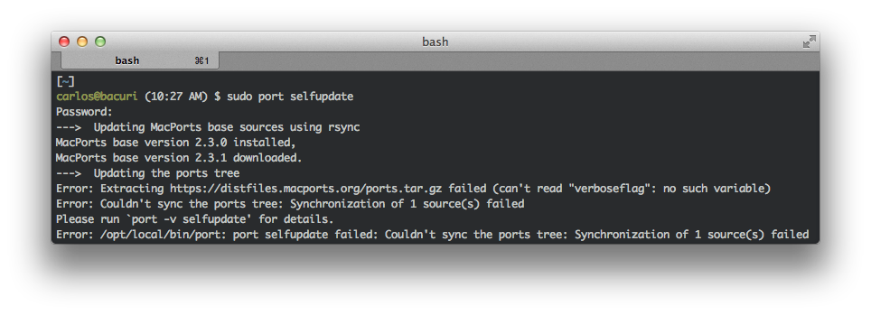
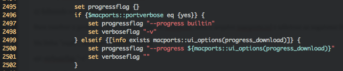
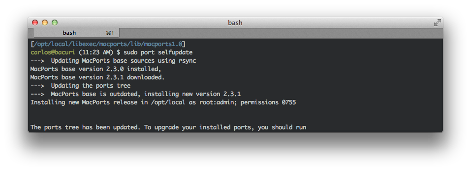

# Consertando o Macports 2.3.0 no OS X Mavericks

Uma das medidas de manutenção que realizo semanalmente em meu macbook é a atualização do macports e dos pacotes que instalo através dele.


Mas nesta última semana, estava ocorrendo o seguinte erro:

[](../../../../assets/wordpress/2014/06/screen-shot-2014-06-29-at-11-31-41-am.png) Erro na atualização do Macports 2.3.0

Procurando pela internet, descobri que há um patch que pode ser aplicado ao arquivo macports.tcl (que fica em /opt/local/libexec/macports/lib/macports1.0) e que resolve o problema. Se você não sabe o que é um patch ou sabe mas nunca utilizou, talvez não seja a melhor idéia utizar um. Neste caso, se você fizer algo de errado - além de "quebrar" a sua instalação do macports, pode também comprometer os ports que você já tem instalado. Então, como a solução é bastante simples, vou mostrar quais são os arquivos que você precisa alterar para ter o seu macports funcionando novamente. Para isso, siga os passos abaixo:

**1) Backup do arquivo original**

Como dito anteriormente, o arquivo de configuração do marports que está com problemas é o "/opt/local/libexec/macports/lib/macports1.0/macports.tcl". Para fazer um backup desse arquivo, abra o terminal e execute os seguintes comandos:


```
$ cd /opt/local/libexec/macports/lib/macports1.0
```


```
$ sudo cp macports.tcl macports.tcl.bak
```


**2) Editando o arquivo macports.tcl**

Para resolver o problema com a atualização do macports, abra o arquivo macports.tcl e adicione as seguintes linhas no arquivo:

Na linha "2498", adicione a seguinte linha:


```
set verboseflag "-v"
```


E na linha "2501", adicione a seguinte linha:


```
set verboseflag ""
```


Salve e feche o arquivo editado.

Fazendo isto, certifique-se de que o seu arquivo possui as mesmas linhas a seguir:

[](../../../../assets/wordpress/2014/06/screen-shot-2014-06-29-at-11-45-27-am.png) Aspecto final do arquivo macports.tcl depois das alterações.

Observe as duas linhas alteradas (2498 e 2501). Estas alterações permitem que a flag "-v" seja verificada quando o comando "sudo port selfupdate" é executado.

**3) Atualizando o macports**

Depois das alterações, execute a atualização do macports ("sudo port selfupdate" ou "sudo port -d sync").

[](../../../../assets/wordpress/2014/06/screen-shot-2014-06-29-at-11-34-35-am.png) Atualizando o macports, problema resolvido!

Com o macports atualizado, basta atualizar os seus pacotes ("sudo port update outdated").

É isso!

**Referências:**

- <https://trac.macports.org/ticket/43821>
- <https://trac.macports.org/changeset/120382>
