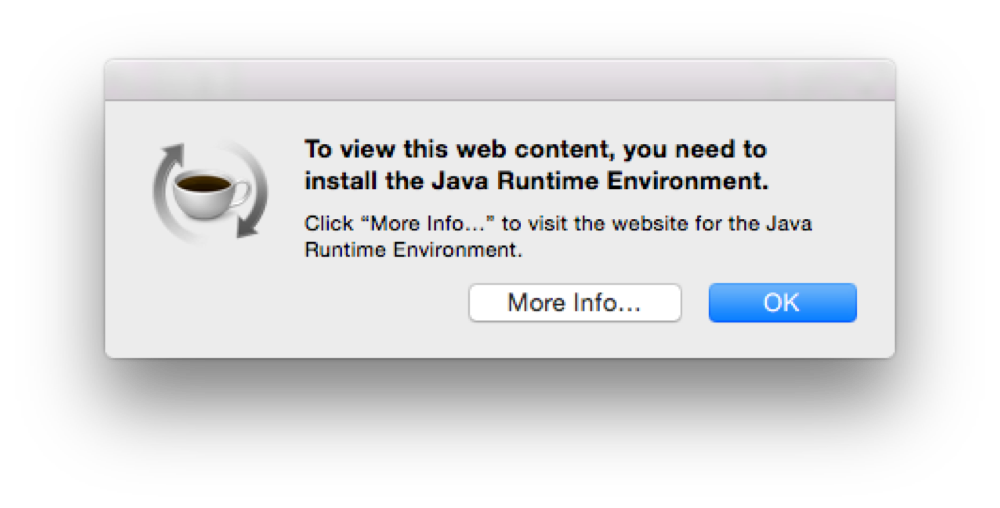

# Migrando o Macports para o OS X Yosemite

Ontém (16/10/2014) foi liberada a versão 10.10 do OS X, batizada de Yosemite. Se você usa o Macports e fez a atualização para o Yosemite, pode estar experienciando alguns problemas.


Logo após a atualização do OS X, fiz a atualização dos meus ports com o comando de praxe:


```
$ sudo port -d sync
```


… e recebi a seguinte mensagem:


```
Error: Current platform "darwin 14" does not match expected platform "darwin 13"
Error: If you upgraded your OS, please follow the migration instructions: https://trac.macports.org/wiki/Migration
OS platform mismatch
while executing
"mportinit ui_options global_options global_variations"
Error: /opt/local/bin/port: Failed to initialize MacPorts, OS platform mismatch
```


Da mesma forma como descrito [aqui](https://trac.macports.org/ticket/44107).

Para solucionar este problema, é bastante simples: basta instalar o [pacote correto](https://distfiles.macports.org/MacPorts/MacPorts-2.3.2-10.10-Yosemite.pkg) do Macports para o OS X Yosemite.

Depois de reinstalado, fui tentar novamente atualizar os meus ports. Ok, tudo funcionando! O problema que surgiu, foi quando tentei fazer o upgrade dos meus ports, com o comando:


```
$ sudo port upgrade outdated
```


Com isso, recebi a seguinte mensagem de erro no Terminal e acompanhada da caixa de diálogo a seguir (em todas as vezes que executei o comando):


```
---> Building antlr
Error: org.macports.build for port antlr returned: command execution failed
Please see the log file for port antlr for details:
 /opt/local/var/macports/logs/_opt_local_var_macports_sources_distfiles.macports.org_ports_lang_antlr/antlr/main.log
Error: Unable to upgrade port: 1
To report a bug, follow the instructions in the guide:
 http://guide.macports.org/#project.tickets
```


 Caixa de diálogo apresentando o erro, referente à versão do Java oficial para o OS X Yosemite.


Pesquisando na interwebs, descobri que a versão do Java estava desatualizada. Instalei a versão 8u25 do JRE e nada! Foi então que neste [link](http://forums.macrumors.com/showthread.php?t=1757743), alguém indicou a instalação do [JRE](http://www.java.net/download/jdk8u40/archive/b09/binaries/jre-8u40-ea-bin-b09-macosx-x86_64-07_oct_2014.dmg) e [JDK](http://www.java.net/download/jdk8u40/archive/b09/binaries/jdk-8u40-ea-bin-b09-macosx-x86_64-07_oct_2014.dmg), ambos na versão 8u40, que na verdade é um pré-release e problema resolvido!
