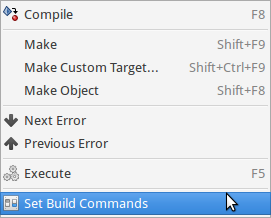
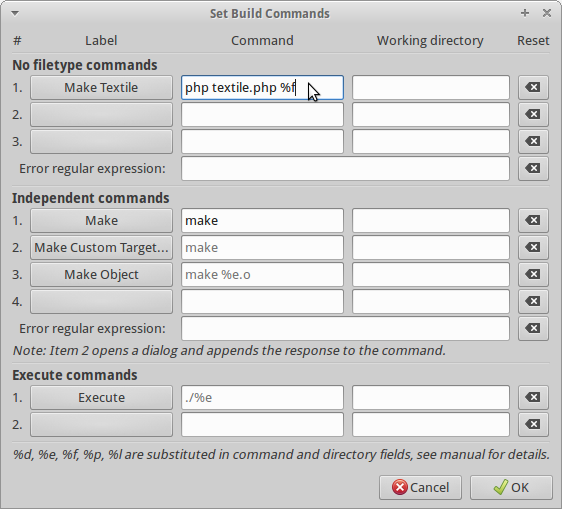
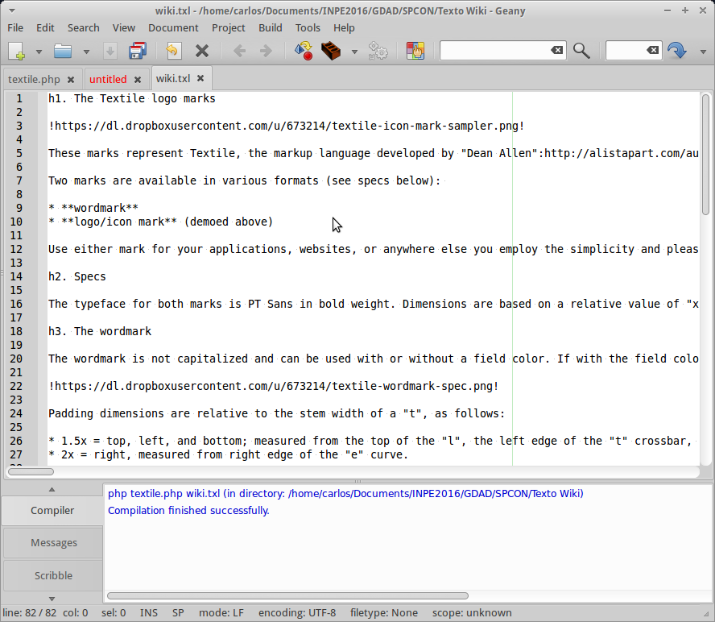
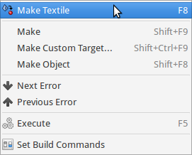
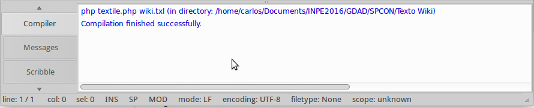
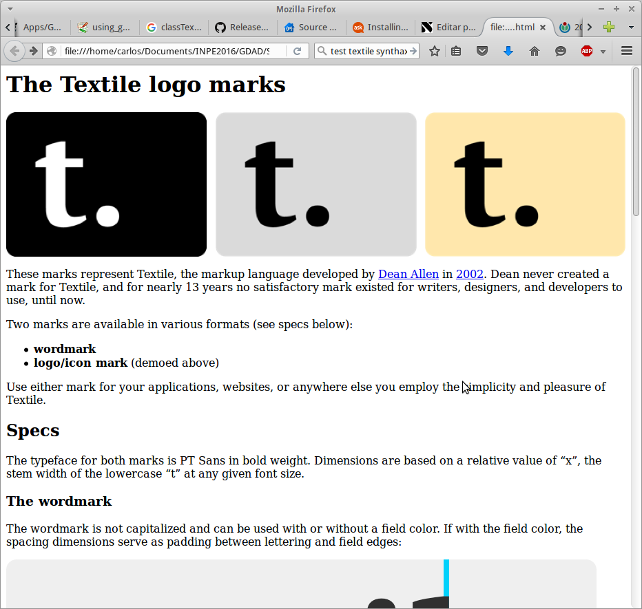

# Editando Textile no Geany

## Introdução

O [Textile](http://txstyle.org/) é uma linguagem de marcação própria para hypertexto do tipo [Wiki](https://pt.wikipedia.org/wiki/Wiki). É simples e fácil de usar, sendo muito mais prática do que o [HTML](http://www.w3schools.com/html/). Assim como no [Markdown](https://daringfireball.net/projects/markdown/) (uma outra linguagem de marcação - veja um post sobre o Markdown [aqui](../../../2014/04/14/markdown-mathjax-uma-alternativa-ao-latex-wp-2330.md)), o Textile permite que você se concentre no conteúdo que está escrevendo, e não na linguagem em si. Linguagens como o HTML, requerem que você saiba exatamente quais são as tags que devem ser utilizadas, obrigando o programador a se concentrar muito mais nas estruturas da linguagem do que no conteúdo em sí. É claro que ninguém escreve textos utilizando as tags do HTML, e é por isso que as linguagem de marcação, como o Textile, existem.


No meu trabalho temos o costume de utilizar o [Redmine](http://www.redmine.org/), um excelente gerenciador de projetos, com suporte ao [SVN](https://pt.wikipedia.org/wiki/Subversion) (subversion) e outras ferramentes de versionamento de código. Nele temos a opção de criar páginas Wiki para documentar os processos envolvidos nos desenvolvimentos e o Textile é a linguagem utilizada. Muitas vezes ocorre de eu querer escrever um texto fora do Redmine e utilizar o que escrevi para coloborar na documentação de algum processo. Se eu não estiver preocupado em escrever para apenas depois formatar, então abro o bloco de notas ou mesmo um editor de textos mais avançado e escrevo o que precisar. Depois que o texto estiver pronto, copio e colo na Wiki do Redmine e formato por lá mesmo, utilizando as ferramentas de edição que ele oferece. Mas e se eu quiser escrever e formatar direto em Textile, comofaz? Uma opção que encontrei foi com o super editor [Geany](http://www.geany.org/), e é esta que vou mostrar aqui.

O Geany é uma excelente [IDE](https://en.wikipedia.org/wiki/Integrated_development_environment) (do inglês "Integrated Development Environment") para programação e oferece suporte para diversas linguagens, possibilitando a compilação através de [Makefiles](https://en.wikipedia.org/wiki/Makefile) dentro da própria IDE. Além disso, posso utilizar o Geany para editar em Textile e "compilar" meus textos, de forma a visualizá-los em HTML dentro de um navegador, se eu quiser. A vantagem de se utilizar o Geany para esta tarefa, desta maneira (utilizando o HTML), é que eu posso  incluir [CSS](http://www.w3schools.com/css/) (do inglês "Cascading Style Sheets", ou simplesmente Folhas de Estilo) e tornar meu texto visualmente mais bonito, ou com o estilo que eu bem entender.

Para podermos utilizar o Geany com suporte ao Textile, ie., de forma a podermos "compilar" um texto Textile e mostrar o resultado em uma página HTML, vamos precisar do [PHP](http://www.w3schools.com/php/).

## **Instalação rápida do PHP(5)**

Neste artigo, estou assumindo que você esteja trabalhado no Ubuntu (minha versão é a 15.10 - Wily Werewolf). Para instalar o PHP, você pode procurar nos repositórios da sua distribuição. Como o objetivo deste artigo não é propriamente mostrar como instalar o PHP, vou utilizar um [PPA](http://askubuntu.com/questions/4983/what-are-ppas-and-how-do-i-use-them) de um terceiro para instalar o PHP5. Se você já possui o PHP instalado e funcionando em sua máquina, você pode pular para a próxima seção.

Para instalar o PHP5 no Ubuntu 15.10, utilize os comando abaixo:


```
$ sudo add-apt-repository ppa:ondrej/php5
$ sudo apt-get update
$ sudo apt-get upgrade
$ sudo apt-get install php5
```


Observe que aqui estamos instalando apenas o PHP. A maioria dos tutoriais que mostram como instalar o PHP, mostram como instalar um servidor Web completo - uma tarefa um pouco mais complexa.

## **Preparando o Geany**

Uma vez que temos o suporte a PHP instalado na máquina, vamos preparar o Geany a compilar um texto escrito em Textile. O primeiro passo, é obter uma cópia do plugin textile para o PHP. Para isso, iremos utilizar o seguinte comando para baixar os pacotes necessários. Sugiro que você baixe o pacote a seguir em um local seguro, onde você não corra o risco de apagar por engano. No meu caso, vou baixar na mesma pasta em que pretendo trabalhar com meus textos em Textile (eg., /home/carlos/Textile):


```
$ cd /home/carlos/Textile
```


```
$ svn export http://textpattern.googlecode.com/svn/development/4.x/ textpattern-read-only
```


Depois disso, precisaremos procurar pelo script "classTextile.php" e lincá-lo na pasta corrente:


```
$ find . -name classTextile.php
```


```
$ ln -s ./textpattern-read-only/textpattern/lib/classTextile.php .
```


Feito o link, iremos apenas criar um script chamado "textile.php" que irá ficar na mesma pasta que o "classTextile.php". O conteúdo deste novo script será (copie o conteúdo abaixo, cole no arquivo e salve com o nome "textile.php"):

```php
&lt;?php

// takes a filename from the commandline and converts its contents
// to a html format

require_once('classTextile.php');

$textile = new Textile;

$file_parts = pathinfo($argv[1]);

$wiki = file_get_contents($file_parts['basename']);

$html = $textile-&gt;TextileThis($wiki);

file_put_contents($file_parts['filename'].&quot;.html&quot;, $html);

// For untrusted user input, use TextileRestricted instead:
// echo $textile-&gt;TextileRestricted($in);

?&gt;
```

Com isso, iremos configurar o Geany de forma a obtermos um comando que utilize o script "textile.php" para compilar os nossos textos com marcação Textile, fazendo uso da classe "classTextile.php" que acabamos lincamos. Para isso, abra o Geany e no menu "Build" (meu Ubuntu está em inglês), clique na opção "Set Build Commands":

 No menu "Build" do Geany, aponte o mouse para "Set Build Commands".

Na janela que abrir, clique no primeiro botão logo abaixo de "Label", e digite um rótulo para o novo comando a ser criado, no meu caso, escolhi "Make Textile". Além disso, insira o comando abaixo no campo à direita do botão criado:


```
php textile.php %f
```


Este é o comando que será executado quando clicarmos na opção "Make Textile" que irá aparecer no meu "Build" quando um arquivo Textile estiver sendo editado.

 Na caixa de edição dos comandos, defina um label para o novo comando "Make Textile" e insira o comando "php textile.php %f".

Com estas opções ajustadas, chegou a hora de editar um documento utilizando a marcação Textile. Para isso, crie um novo arquivo no Geany e a salve com a extensão ".txl" (na realidade, pode ser outra), mas é importante que o nome do arquivo seja "wiki". Para mostrar o exemplo deste artigo, o arquivo que estou editando está [aqui](https://github.com/textile/textile-mark/blob/master/README.textile).

 No Geany, digite o texto com a marcação Textile e salve o arquivo com o nome "wiki.txl".

Com o documento aberto, clique novamente no menu "Build" e veja que uma nova opção surgiu: "Make Textile", que é justamente a opção para o comando que inserimos anteriormente para podermos "compilar" nosso documento escrito com marcação Textile.

 Depois de digitar o texto na janela de edição do Geany, clique no menu "Build" e aponte o mouse para o novo comando criado "Make Textile".

Para se certificar de que a compilação ocorreu corretamente, no rodapé do editor deverá surgir a seguinte mensagem em azul:

 Uma vez que o comando é completado com sucesso, você verá a mensagem abaixo, em azul.

Se tudo correu bem, você deverá obter um arquivo chamado "wiki.html" que poderá ser aberto no seu navegador. Este arquivo será criado na mesma pasta em que o arquivo "wiki.txl" foi salvo.

 Com o documento compilado, abre o arquivo "wiki.html" no seu navegador e veja o resultado!


## Conclusão

Neste artigo vimos como utilizar a IDE do Geany para escrevermos textos com marcação Textile sem a necessidade de termos uma Wiki instalada no computador (e sem termos que instalar um servidor Web para isso). O Geany tem muitas possibilidades e funcionalidades e isso permite que novos formatos possam ser utilizados por ele.

Utilizando uma página em HTML para visualizar o arquivo formatado, é ainda possível modificá-lo e adicionar marcação CSS para modificar a apresentação do texto.

É isso!

## **Referências**

- <http://wiki.geany.org/using_geany_a_textile_wiki_editor>
- <http://askubuntu.com/questions/462673/installing-php-5-3-in-ubuntu-14-04>
- <https://code.google.com/p/textpattern/source/browse/development/4.x/textpattern/lib/classTextile.php?r=3359>
- <https://github.com/textile/textile-mark/blob/master/README.textile>
