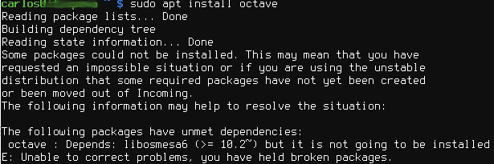

# Problema com a libosmesa6 no Linux Mint 18.3 &quot;Sylvia&quot;

Recentemente, formatei minha máquina de trabalho e aproveitei para fazer duas coisas: 1) fazer um RAID 0 entre dois HDs de 1TB disponíveis e 2) instalar o Linux Mint 18.3 "Sylvia".

O RAID 0 foi uma solução melhor para o aproveitamento dos HDs da máquina e o Linux Mint, para sanar algumas coisas que já estavam me incomodando no Ubuntu. Obviamente, estas mesmas coisas continuam a me incomodar no Linux Mint, visto que ele é uma distribuição baseada no Ubuntu. Entre estas coisas, estão alguns problemas de instabilidade com o [Terminator](https://gnometerminator.blogspot.com.br/p/introduction.html) (emulador de terminal) que de vez em quanto fecha (com todas as minhas abas e seções). Mas uma coisa que estou gostando bastante no Linux Mint, é a forma com a qual trata as atualizações do sistema. O sistema de notificações é funcional e descomplicado.

Mas eis que precisei instalar o [Octave](https://www.gnu.org/software/octave/) e tive um problema com a "[libosmesa6](https://packages.ubuntu.com/trusty/libs/libosmesa6)":

 Problema com a instalação do Octave no Linux Mint 18.3 "Sylvia"

Uma pequena busca no Google me levou a esta página do [askubuntu](https://askubuntu.com/questions/943647/intel-graphic-installer-2-0-2-fails-on-fresh-ubuntu-16-04) com uma solução para um outro problema, e que resolveu o meu também. Neste caso, o repositório estava acusando uma versão diferente da "libosmesa6" enquanto a instalação do Octave requeria uma outra versão. Pelo [visto](https://bugs.launchpad.net/ubuntu/+source/mesa/+bug/1709823), isto é um bug e aparentemente já deveria ter sido disponibilizada para as distribuições baseadas no Ubuntu. A solução foi instalar o pacote do "mesa-utils" com a versão requerida, disponibilizada através de um repositório "ppa".


```
sudo add-apt-repository ppa:paulo-miguel-dias/pkppa
sudo apt update
sudo apt upgrade
```


E depois disso, a instalação do Octave correu bem com um simples


```
sudo apt install octave
```


É isso!

**Referências:**

- <https://askubuntu.com/questions/943647/intel-graphic-installer-2-0-2-fails-on-fresh-ubuntu-16-04>
- <https://bugs.launchpad.net/ubuntu/+source/mesa/+bug/1709823>
